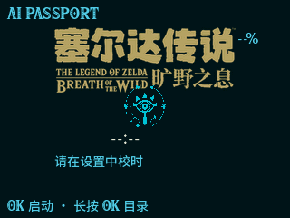
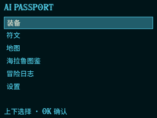
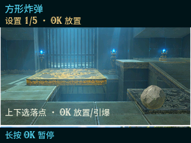
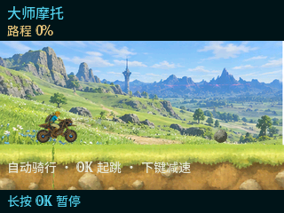

# 🗡️ 希卡石板 · Sheikah Slate

> 一块真的能玩的希卡石板 —— 基于 ESP32-C3 的《塞尔达传说：旷野之息》
> 希卡石板复刻。320×240，全离线，开机即玩，不需要网——因为一万年前也没有。

| 开机 | 主菜单 |
|---|---|
|  |  |
| *符文小游戏* | *大师摩托* |
|  |  |

## 这是什么

不是模拟器，也不是动态壁纸。一块真实的 320×240 硬件
（ESP32-C3 + ST7789 屏 + 三个按键 + I2S 音效），把《旷野之息》的希卡石板
界面整个装了进去，连同样能玩、能输、能重来的符文小游戏。
没有 Wi-Fi，没有蓝牙，没有 App —— 石板就该这样。

## 石板上有什么

| 功能 | 内容 |
|---|---|
| ⚔️ 装备 | 九宫格装备菜单，分类浏览、选中试装 |
| 🔯 符文 | 九项符文小游戏：圆/方炸弹、磁力抓取、静止器、制冰器、相机、感应器、amiibo、大师摩托——固定视角、可完成、可失败、可重试 |
| 🗺️ 地图 | 全海拉鲁一张图，177 个游戏原始命名点位，缩放、横移、纵移 |
| 📖 海拉鲁图鉴 | 394 条全量图鉴（含大师模式金色怪），中英文名齐全 |
| 📜 冒险日志 | 152 条任务：主线 / 神庙挑战 / 迷你挑战，含全部 DLC 与联动，中英双语 |
| ⚙️ 设置 | 音量、亮度、扫描线、校时、息屏、中英切换 |

音效直接播放游戏原声 WAV：开锁、烹饪、磁力移动、时停蓄力……
操作只有三个键 **UP / OK / DOWN**；OK 长按暂停或返回。

## 先在浏览器里玩

设备还没到手？原型和真机是同一套界面：

```bash
python -m http.server 8124 --bind 127.0.0.1
# 打开 http://127.0.0.1:8124/prototype/
```

预览要求和页面说明见 [prototype/README.md](prototype/README.md)。

## 烧进真机

硬件是 FoloToy AI Passport（ESP32-C3，8MB Flash，ST7789 240×320 SPI 屏，
三键 ADC 分压，ES8311 音效，CW2017 电量计）。需要 ESP-IDF 环境：

- 构建、烧录与硬件规格：[docs/hardware/hardware.md](docs/hardware/hardware.md)
- 固件为全离线 V1，app 与设备资源包必须配套烧录；也可合并为单一整包一次写入，见 [docs/hardware/offline-v1.md](docs/hardware/offline-v1.md) 的[合并烧录包](docs/hardware/offline-v1.md#合并烧录包)

## 仓库地图

```
prototype/   浏览器原型 —— 就是上面让你先玩的那套界面
firmware/    ESP-IDF 固件（main/offline/ + components/bsp/）
assets/      素材：raw（原作/授权生成）→ gen（管线产物）
tools/       素材与数据管线脚本
docs/        文档索引、架构、硬件、原型说明与历史
```

依赖是单向的：`assets/raw → tools → assets/gen → firmware/ 与 prototype/`，
详细边界见 [docs/architecture.md](docs/architecture.md)；按任务查文档从
[文档索引](docs/README.md) 进。

## 声明

代码以 MIT 许可发布。《塞尔达传说》相关名称与游戏素材权利归 Nintendo 所有；
本项目的图像素材多为参考实机授权生成的风格替代，音效取自个人合法获得的游戏
解包资源，来源与限制见 [docs/assets/provenance.md](docs/assets/provenance.md)。
