# 🗡️ 希卡石板 · Sheikah Slate

> 一块真的能玩的希卡石板 —— 基于 ESP32-C3 的《塞尔达传说：旷野之息》
> 希卡石板复刻。320×240，全离线，开机即玩，不需要网——因为一万年前也没有。

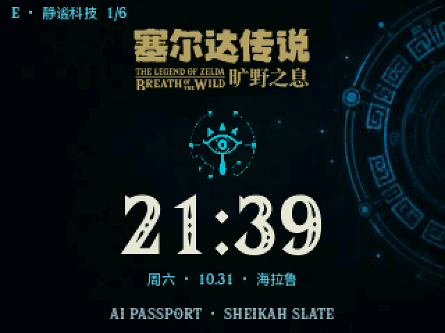

## 这是什么

给 FoloToy AI Passport 写的固件。刷进去之后，这台 ESP32-C3 小机器
以 320×240 的屏幕和三个按键呈现《旷野之息》的希卡石板：
装备、九项能力、图鉴、冒险日志、地图、相册和待机画布，全部离线运行。
同时保留纯 HTML/CSS/JavaScript 浏览器原型，方便先体验界面和玩法。

[项目仓库](https://github.com/YeatsLiao/ai-passport-sheikah-slate) ·
[文档索引](docs/README.md) · [素材与依赖来源](#素材数据与参考项目)

核心功能已完成，拆分后的固件已构建并由用户确认实机回归正常。
后续新增音效及合并烧录包的验证进展以 [当前状态](docs/context/NOW.md) 为准；
下方截图展示的是已记录的实机版本。

## 石板上有什么

- **九项符文与能力模拟** —— 圆/方炸弹、磁力抓取、静止器、制冰器、相机、
  感应器、amiibo、大师摩托。围绕三键设计投掷引爆、铁板搭桥、滚石时停、冰柱通路、
  取景识别、骑行跳跃、补给开箱和神庙寻踪，可暂停与重试。
- **海拉鲁图鉴** —— 394 条全量数据（含大师模式金色怪），中英文名齐全，可登记。
- **冒险日志** —— 152 条任务，含全部 DLC 与《异度之刃 2》联动，双语梗概。
- **地图** —— 177 个游戏原始命名点位，缩放、横移、纵移。
- **相册** —— 12 张固定照片，可放大查看、删除。
- **系统** —— 中英切换、音量、亮度、扫描线、USB 校时、六款待机画布、
  背景主题、电量显示。

操作只有三个键 **UP / OK / DOWN**：OK 长按暂停或返回。
原型播放原作 WAV；设备将音效转为 ADPCM 后分块解码播放，覆盖菜单、
装备、符文、开箱和完成提示。完成旋律采用烹饪成功音效。
运行所需的 43 个 WAV 和来源清单随仓库提供（约 11.21 MiB），克隆后即可使用，
无需额外复制个人归档。来源见下方表格与 [素材说明](assets/README.md)。

## 实机一览

| 主菜单 | 符文选择 |
|---|---|
| 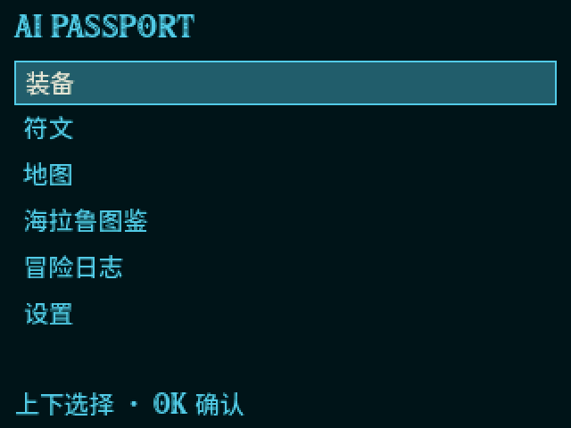 | 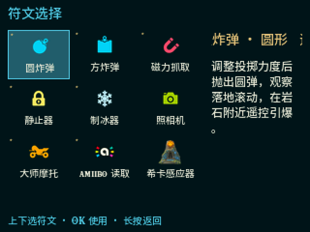 |
| **装备** | **图鉴** |
| 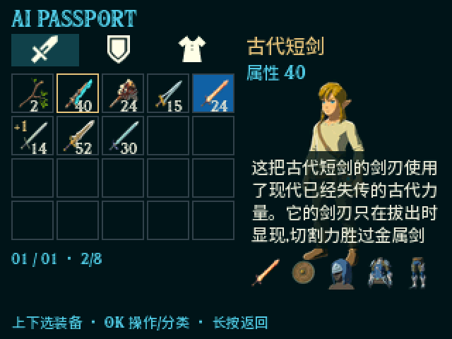 | 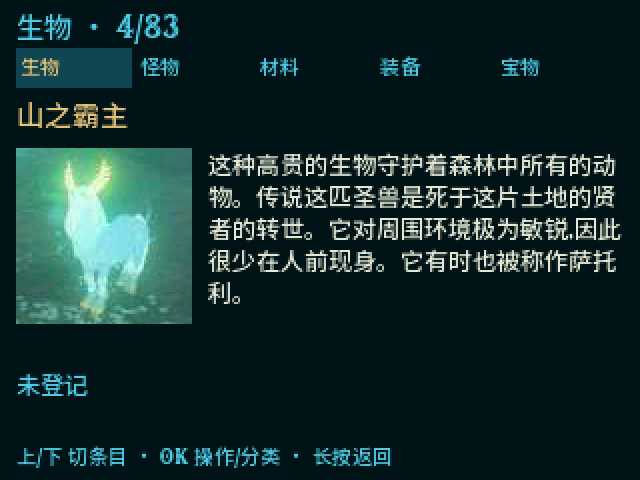 |
| **相机 · 识别成功** | **冒险日志** |
| 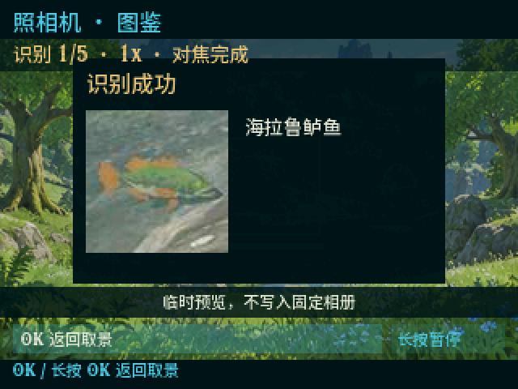 | 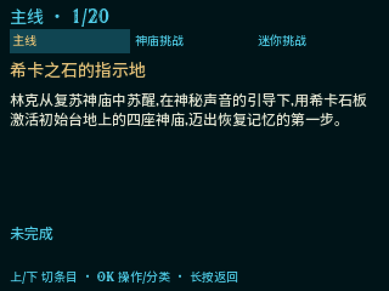 |

## 九项符文与能力模拟

| 圆炸弹 | 方形炸弹 | 磁力抓取 |
|---|---|---|
| 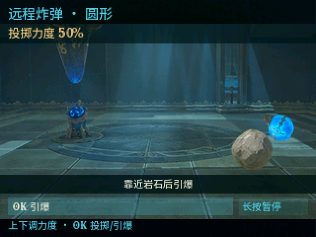 | 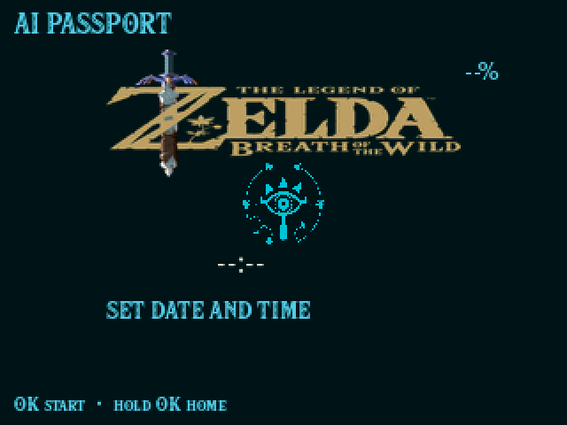 | 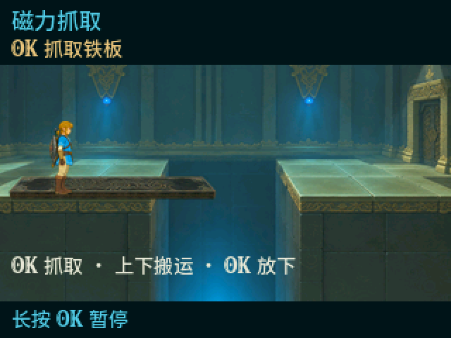 |
| **静止器** | **制冰器** | **希卡感应器** |
| 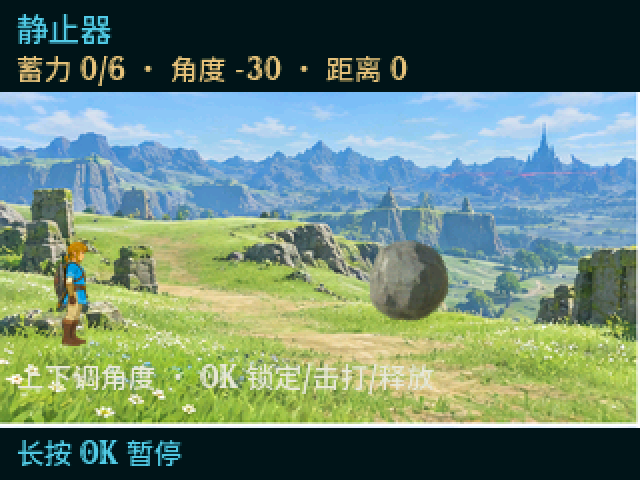 | 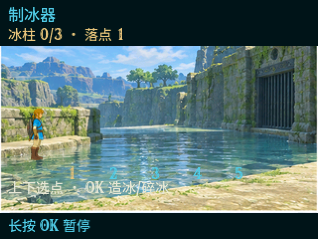 | 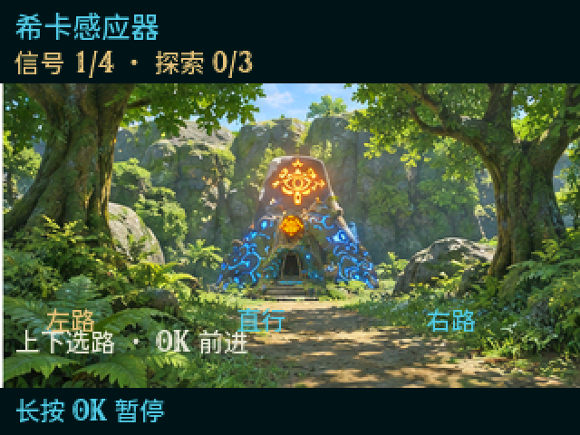 |
| **大师摩托** | **amiibo** | **相机 · 识别成功** |
| 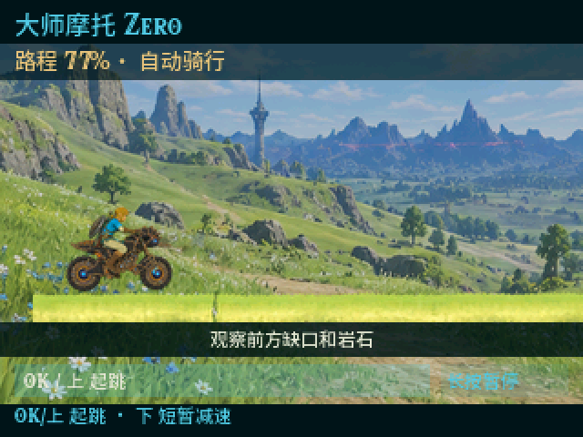 | 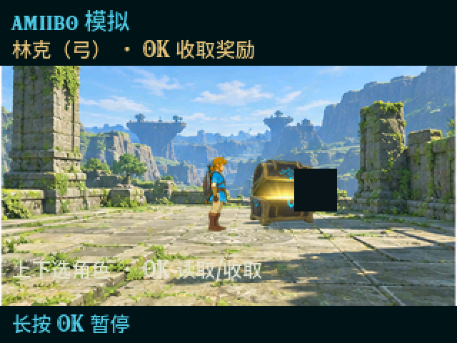 |  |

## 六款待机画布

横竖屏自适应，自动轮换，熄屏唤醒。

| 静谧科技 | 晨光旷野 | 古地图 |
|---|---|---|
|  | 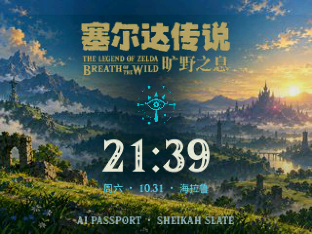 | 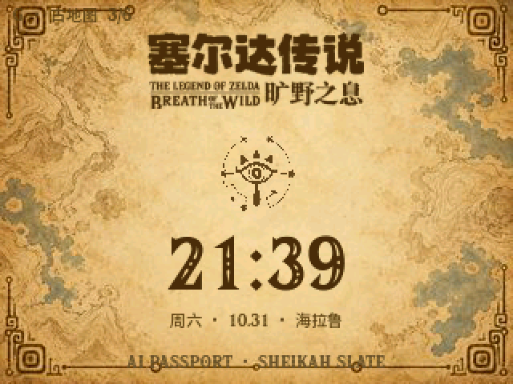 |

竖屏款（神庙石碑 / 林间薄雾）与黑金款见
[assets/docs/MANIFEST.md](assets/docs/MANIFEST.md)。

## 三键操作

| 场景 | UP / DOWN | 短按 OK | 长按 OK |
|---|---|---|---|
| 主目录、列表 | 选择项目 | 进入或确认 | 返回 |
| 装备、分类及操作菜单 | 选择格子或选项 | 装备、卸下或确认 | 逐层关闭 |
| 图鉴、日志详情 | 阅读正文 | 登记或切换任务状态 | 返回列表 |
| 符文场景 | 调整力度、落点、角度或搬运等 | 当前主动作 | 暂停菜单 |
| 地图 | 按当前模式平移或缩放 | 切换横移、纵移、缩放 | 返回目录 |
| 设置 | 选择项目或调整数值 | 进入修改、保存 | 退出修改或返回 |

所有操作按单键顺序完成，不要求同时按键；各符文具体动作见屏内提示。
设备没有真实摄像头、GPS 或主动 NFC 读卡能力，相机、感应器和 amiibo 为离线模拟。

## 先在浏览器里玩

设备还没到手？原型和真机出自同一套设计与数据：

```bash
python -m http.server 8124 --bind 127.0.0.1
# 打开 http://127.0.0.1:8124/prototype/
```

浏览器原型无需 npm 安装或前端构建。从仓库根启动，保持 prototype 与 assets 同级。

预览要求和页面说明见 [prototype/README.md](prototype/README.md)。

## 烧进真机

硬件是 FoloToy AI Passport（ESP32-C3，8MB Flash，ST7789 240×320 SPI 屏，
三键 ADC 分压，ES8311 音频，CW2017 电量计，无 PSRAM）。运行时不使用 Wi-Fi、
蓝牙、云服务或 OTA；USB 用于烧录、截图及离线校时。

依赖版本以 [组件声明](firmware/components/bsp/idf_component.yml) 为准：
ESP-IDF >=5.5.3、<5.6.0，LVGL 9.5.0，esp_lvgl_port 2.9.0，
button 4.2.0，esp_codec_dev 1.6.2。首次准备开发环境与依赖可能需要网络。

从源码开始：先按 [工具说明](tools/README.md) 准备素材及生成设备资源，
再在已配置的 ESP-IDF 环境中从仓库根执行：

```bash
idf.py -C firmware build
idf.py -C firmware -p COMx flash monitor
```

COMx 替换为实际端口。当前构建配置会把 resources.bin 加入 flash 目标，
app 和资源包必须来自同一版本；也可按专题说明生成合并烧录包。
电脑校时和 USB 截图入口分别为根目录 sync-time.cmd、screenshot.cmd，
使用前关闭占用串口的 monitor。完整步骤见：

- 构建、烧录与硬件规格：[docs/hardware/hardware.md](docs/hardware/hardware.md)
- 固件为全离线 V1，app 与设备资源包必须配套烧录；整包流程见
  [docs/hardware/offline-v1.md](docs/hardware/offline-v1.md)

## 仓库地图

```
prototype/   浏览器原型 —— 就是上面让你先玩的那套界面
firmware/    ESP-IDF 固件（main/offline/ + components/bsp/）
assets/      素材：生成图池 + 原型引用件（原作解包原料外迁归档）
tools/       资源包生成、数据管线、设备通信脚本
docs/        文档索引、架构、硬件、原型说明与历史
```

依赖是单向的：`素材 → tools → assets/gen → firmware/ 与 prototype/`，
详细边界见 [docs/architecture.md](docs/architecture.md)；按任务查文档从
[文档索引](docs/README.md) 进。

## 素材、数据与参考项目

下表按实际用途列出直接素材、数据源、工具和设计参考。第三方仓库的代码许可
不代表其中游戏图片、字体或音频获得相同授权；生成图与社区加工件也单独注明。
历史导入批次和逐项说明见 [素材来源记录](docs/assets/provenance.md)，
现有目录及归档边界见 [资产地图](assets/README.md)。旧来源记录中的 raw 路径属于
归档时结构，当前输入已移至 assets/ui、fonts、maps、gen 等目录。

| 类型 | 来源 / 链接 | 本项目用途与说明 |
|---|---|---|
| 图鉴照片与元数据 | [gadhagod/Hyrule-Compendium-API](https://github.com/gadhagod/Hyrule-Compendium-API) · [文档](https://gadhagod.github.io/Hyrule-Compendium-API/) | 图鉴编号、英文数据和照片；本地保存后离线使用，运行时不请求 API；上游代码 MIT |
| 分类图标 | [arjunkahlon/hyrule-compendium](https://github.com/arjunkahlon/hyrule-compendium) | 图鉴分类辅助图片；历史 package.json 标注 ISC，游戏图片权利另计 |
| 装备、立绘与字体 | [flagrede/zelda-botw-starter](https://github.com/flagrede/zelda-botw-starter) | 装备透明图、林克立绘、Hylia Serif、保留的 Calamity 字体；原菜单 MP3 已停用；未确认独立素材许可 |
| UI 设计参考 | [react-sheikah-ui](https://www.npmjs.com/package/react-sheikah-ui) | 历史配色与组件设计参考，未引入 React 运行依赖；准确仓库地址待核实，保留包名入口 |
| 游戏 UI 图标、符文、希卡文字 | [Zelda Wiki / Breath of the Wild](https://zeldawiki.wiki/wiki/The_Legend_of_Zelda:_Breath_of_the_Wild) | 界面件及实机参考；旧批次部分单图原始页面未记录，详见来源记录，不能统一宣称官方提取 |
| 英文标题 | [BotW English Logo 文件页](https://zeldawiki.wiki/wiki/File:BotW_English_Logo.png) | E3 Press Kit 来源，经社区透明处理和缩小 |
| 简体中文标题 | [BotW Simplified Chinese Logo 文件页](https://zeldawiki.wiki/wiki/File:BotW_Simplified_Chinese_Logo.png) | 页面署名 Htwretched；由繁体标题和视频重建的社区版本 |
| 电量 HUD 参考 | [Gaming Reinvented 报道](https://gamingreinvented.com/news/tears-of-the-kingdom-previews-reveal-tons-of-new-info/) · [原截图](https://gamingreinvented.com/wp-content/uploads/2023/04/BatteryIcons.jpg) | 《王国之泪》三格能量槽，裁切用于原型电量显示 |
| 神庙场景参考 | [Namika Ozz Shrine 文件页](https://zeldawiki.wiki/wiki/File:BotW_Namika_Ozz_Shrine.png) · [原图](https://cdn.wikimg.net/en/zeldawiki/images/c/ca/BotW_Namika_Ozz_Shrine.png) | 感应器神庙画面与生成参考 |
| amiibo 构图参考 | [Nintendo Life 实机报道](https://www.nintendolife.com/news/2016/12/the_legend_of_zelda_30th_anniversary_amiibo_provide_food_and_goodies_in_breath_of_the_wild) | 查阅掉落构图；图片下载未成功，未用作生成文件输入 |
| 场景、透明物件、人物动作与待机画布 | [本项目生成素材](assets/gen/) · [生成来源说明](docs/assets/provenance.md#九项符文场景与透明物件-v2) | 部分位图用 ImageGen 参考游戏生成；背景候选另有程序生成件，均非官方游戏资产；保留的 SVG/UI 件可在 assets/ui 查阅 |
| 地图底图 | [ZeldaMods Object Map](https://objmap.zeldamods.org/) · [底图资源](https://objmap.zeldamods.org/game_files/maptex/base.png) | 无 HUD 海拉鲁底图，服务器返回 WebP；派生为设备地图瓦片 |
| 地点坐标 | [leoetlino/botw / Static.mubin.yml](https://github.com/leoetlino/botw/blob/master/Map/MainField/Static.mubin.yml) | 提取有名称的 LocationMarker，生成 177 点位 |
| 地点英文文本 | [ZeldaMods LocationMarker.json](https://objmap.zeldamods.org/game_files/text/StaticMsg/LocationMarker.json) | 点位英文名 |
| 地点双语文本 | [BotW Text Dump / StaticMsg](https://sh0wer1ee.github.io/BotwText/page/StaticMsg.html) | 按 MessageID 提取中文与英文名称 |
| 主线与迷你挑战 | [主线清单](https://zeldawiki.wiki/wiki/Main_Quests_in_Breath_of_the_Wild) · [迷你挑战清单](https://zeldawiki.wiki/wiki/Side_Quests_in_Breath_of_the_Wild) | 任务名称、本体与 DLC 分类；双语梗概由项目概述和翻译 |
| 联动任务 | [Xenoblade Chronicles 2](https://zeldawiki.wiki/wiki/Xenoblade_Chronicles_2) | 联动任务条件及名称参考 |
| 神庙挑战 | [Zelda Central](https://zeldacentral.com/games/breath-of-the-wild/shrine-quests/) · [17173 中文清单](https://news.17173.com/z/zeldabotw/content/01102023/135006330.shtml) | 神庙挑战名称、目标与社区译名参考 |
| 中文字体 | [Adobe Source Han Sans](https://github.com/adobe-fonts/source-han-sans) · [Medium 原件](https://github.com/adobe-fonts/source-han-sans/blob/release/OTF/SimplifiedChinese/SourceHanSansSC-Medium.otf) · [OFL 许可](assets/fonts/SourceHanSans-LICENSE.txt) | 思源黑体 SC Medium，作为中文风格替代；Hylia Serif 不含汉字；设备字库由源字体裁制 |
| 中文排版参考 | [机核文章](https://www.gcores.com/articles/121967) | 原作中文标题与正文排版分析 |
| 菜单与能力音效 | [The Sounds Resource：Miscellaneous 1/3](https://sounds.spriters-resource.com/nintendo_switch/thelegendofzeldabreathofthewild/asset/405753/) · [2/3](https://sounds.spriters-resource.com/nintendo_switch/thelegendofzeldabreathofthewild/asset/405754/) | 上传者 Random Talking Bush；用户提供原文件，事件映射由项目适配 |
| 烹饪成功与摩托音效 | [The Sounds Resource：BotW 资源目录](https://sounds.spriters-resource.com/nintendo_switch/thelegendofzeldabreathofthewild/) · [导入工具](tools/sfx/) | 用户提供的 Equipment / Item_CookSet 与 GameROMMotorcycle；具体包页面待补录，保留原 WAV、哈希及循环边界 |

### 固件与加工工具

| 项目 / 链接 | 用途 | 当前声明 |
|---|---|---|
| [FoloToy](https://folotoy.com/) | AI Passport 硬件平台 | 本项目的板级适配见 [硬件文档](docs/hardware/hardware.md) |
| [Espressif ESP-IDF](https://github.com/espressif/esp-idf) | ESP32-C3 SDK、FreeRTOS、LCD、USB、NVS | >=5.5.3、<5.6.0 |
| [LVGL](https://github.com/lvgl/lvgl) | 设备 UI 与图像显示 | 9.5.0 |
| [esp_lvgl_port](https://components.espressif.com/components/espressif/esp_lvgl_port) | LVGL 与 ESP-IDF 接入 | 2.9.0 |
| [button](https://components.espressif.com/components/espressif/button) | ADC 三键驱动 | 4.2.0 |
| [esp_codec_dev](https://components.espressif.com/components/espressif/esp_codec_dev) | ES8311 音频驱动 | 1.6.2 |
| [lv_font_conv](https://github.com/lvgl/lv_font_conv) | 设备字体裁制 | tools/package.json |
| [Sharp](https://github.com/lovell/sharp) · [resvg-js](https://github.com/thx/resvg-js) | 图像及 SVG 加工工具 | tools/package.json；原型运行无需这些依赖 |
| [Python](https://www.python.org/) · [Pillow](https://github.com/python-pillow/Pillow) | 素材转换、资源打包、本地静态服务 | 各脚本前置条件见 tools/README |
| [Node.js](https://nodejs.org/) | 静态数据导出和字体工具 | 仅开发与资源加工时使用 |
| [pyserial](https://github.com/pyserial/pyserial) · [PyYAML](https://github.com/yaml/pyyaml) | USB 通信、地图 YAML 读取 | 按对应工具需要准备 |

## 已知限制

- 地图缩放档位（1×/2×/4×）少于原型（最高 16×）；部分页面布局与原型仍有差异

## 声明

本项目为爱好者学习与展示作品，与 Nintendo 无隶属或官方合作关系。
《塞尔达传说》相关名称、角色、游戏画面与音效的权利归各自权利人所有。
游戏原作素材、社区加工件、参考游戏生成图和项目代码应分别看待其来源及许可；
“可下载”或“仓库代码开源”不等于游戏素材可自由再分发。

当前根目录尚无 LICENSE 文件，代码发布许可待补充；此处不将全部素材声明为 MIT。
字体遵循所附 OFL 许可。素材的具体来源与署名边界见 [来源记录](docs/assets/provenance.md)。
